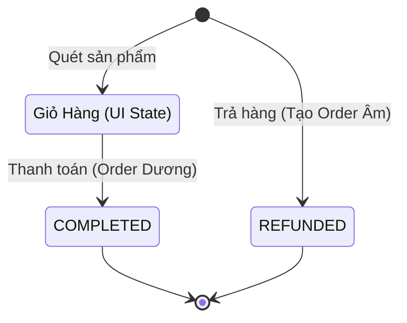

# Phân Tích DB Local & Thiết Kế State Machine Đơn Hàng (POS Souvenir Bitexco)

Tài liệu này phân tích thiết kế Cơ sở dữ liệu local (Local DB) và Máy trạng thái (State Machine) cho các đơn hàng dựa trên quy trình nghiệp vụ tối giản của cửa hàng bán đồ lưu niệm.

> [!IMPORTANT]
> **Nguyên tắc thiết kế Offline-First:**
>
> 1. Toàn bộ các bảng sử dụng khóa chính `id` kiểu `String` (UUID) thay vì tự tăng (Auto-increment).
> 2. Tất cả các bảng đều có các trường đồng bộ: `is_deleted` (Boolean - dùng để xóa mềm), `sync_status` (String: `DRAFT`, `PENDING`, `SYNCED`, `FAILED`), `created_at` (Number), và `updated_at` (Number).

---

## 1. Thiết Kế Cơ Sở Dữ Liệu Local (WatermelonDB Schema)

### 1.1 Bảng `staff` (Nhân viên)

Lưu thông tin nhân viên phục vụ cho việc Đăng nhập & Mở ca.

- `id` (String): UUID.
- `username` (String): Tên đăng nhập.
- `fullname` (String): Tên hiển thị.
- `role` (String): `ADMIN`, `MANAGER`, `CASHIER`.
- `pin_hash` (String): Mã PIN mã hóa để đăng nhập nhanh.
- `is_active` (Boolean): Trạng thái hoạt động.
- `is_deleted` (Boolean): Cờ xóa mềm.
- `created_at` / `updated_at` (Number).

### 1.2 Bảng `shifts` (Ca làm việc)

Quản lý dòng tiền và phiên làm việc của Thu ngân.

- `id` (String): UUID.
- `staff_id` (String): Liên kết với `staff.id`.
- `device_id` (String): ID máy POS vật lý.
- `start_time` (Number): Thời gian mở ca.
- `end_time` (Number): Thời gian đóng ca (null nếu đang mở).
- `starting_cash` (Number): Tiền mặt đầu ca.
- `expected_ending_cash` (Number): Tiền mặt hệ thống tính toán lúc đóng ca.
- `actual_ending_cash` (Number): Tiền mặt thực tế kiểm đếm cuối ca.
- `difference_cash` (Number): Tiền chênh lệch âm/dương.
- `discrepancy_reason` (String): Lý do chênh lệch tiền mặt (nếu có).
- `status` (String): `OPEN`, `CLOSED`.
- `is_deleted` (Boolean): Cờ xóa mềm.
- `created_at` / `updated_at` (Number).

### 1.3 Bảng `categories` (Danh mục sản phẩm)

- `id` (String): UUID.
- `name` (String): Tên danh mục (VD: Móc khóa, Nón, Áo thun).
- `color` (String): Mã màu hiển thị trên POS.
- `display_order` (Number): Thứ tự hiển thị.
- `created_at` / `updated_at` (Number).

### 1.4 Bảng `products` (Sản phẩm)

- `id` (String): UUID.
- `category_id` (String): Liên kết với `categories.id`.
- `sku` (String): Mã vạch hoặc mã sản phẩm nội bộ.
- `name` (String): Tên sản phẩm.
- `price` (Number): Giá bán lẻ.
- `cost_price` (Number): Giá vốn nhập hàng (phục vụ tính lãi gộp cho Manager).
- `stock` (Number): Số lượng tồn kho tại máy POS.
- `image` (String): URL/Đường dẫn ảnh local.
- `is_active` (Boolean).
- `created_at` / `updated_at` (Number).

### 1.5 Bảng `orders` (Đơn hàng)

_Lưu ý: Đơn hàng chỉ được tạo trong DB tại thời điểm Thanh toán thành công. Chứa toàn bộ snapshot sản phẩm và thanh toán để truy vấn siêu nhanh._

- `id` (String): UUID/Mã đơn (VD: ORD-12345).
- `shift_id` (String): Liên kết với `shifts.id`.
- `staff_id` (String): Liên kết với `staff.id`.
- `status` (String): Trạng thái đơn hàng (`COMPLETED`, `REFUNDED`).
- `subtotal` (Number): Tổng tiền trước giảm giá.
- `discount` (Number): Số tiền giảm giá.
- `voucher_code` (String): Mã Voucher áp dụng (nếu có).
- `voucher_discount` (Number): Số tiền được giảm từ Voucher.
- `total` (Number): Tổng tiền thanh toán cuối cùng (`subtotal - discount - voucher_discount`).
- `refund_reason` (String): Lý do hoàn tiền (nếu có).
- `original_order_id` (String): ID của hóa đơn gốc (nếu đơn này là bút toán hoàn trả).
- `customer_tax_info` (String/JSON): Thông tin xuất HĐĐT (Tên Cty, MST, Email).
- `items_snapshot` (String/JSON): Dạng chuỗi JSON lưu mảng sản phẩm để query nhanh.
  ```json
  [
    {
      "productId": "prod-uuid",
      "productName": "Móc khóa Bitexco",
      "price": 50000,
      "quantity": 2,
      "subtotal": 100000
    }
  ]
  ```
- `payments_snapshot` (String/JSON): Dạng chuỗi JSON lưu mảng hình thức thanh toán để query nhanh.
  ```json
  [
    {
      "method": "CASH",
      "amount": 50000,
      "cashTendered": 100000,
      "cashChange": 50000
    },
    {
      "method": "CARD",
      "amount": 50000,
      "referenceCode": "VNP12345678",
      "cardType": "VISA"
    }
  ]
  ```
- `is_deleted` (Boolean): Cờ xóa mềm.
- `created_at` / `updated_at` (Number).

### 1.6 Bảng `order_items` (Dòng Chi Tiết Hóa Đơn)

Lưu dữ liệu quan hệ chuẩn cho báo cáo chuyên sâu.

- `id` (String): UUID.
- `order_id` (String): Liên kết với `orders.id`.
- `product_id` (String): Liên kết với `products.id`.
- `product_name_snapshot` (String): Tên sản phẩm lúc chốt bill.
- `price_snapshot` (Number): Giá sản phẩm lúc chốt bill.
- `quantity` (Number): Số lượng mua.
- `refunded_quantity` (Number): Số lượng sản phẩm đã hoàn trả (mặc định 0).
- `subtotal` (Number): `price * quantity`.
- `is_deleted` (Boolean): Cờ xóa mềm.
- `created_at` / `updated_at` (Number).

### 1.7 Bảng `payments` (Lịch sử thanh toán)

Lưu dữ liệu quan hệ chuẩn cho kế toán.

- `id` (String): UUID.
- `order_id` (String): Liên kết với `orders.id`.
- `method` (String): `CASH`, `CARD`, `BANK_TRANSFER`.
- `amount` (Number): Số tiền thanh toán.
- `cash_tendered` (Number): Số tiền khách đưa.
- `cash_change` (Number): Tiền thừa.
- `reference_code` (String): Mã Trace giao dịch ngân hàng.
- `card_type` (String): Loại thẻ/Kênh thanh toán.
- `is_deleted` (Boolean): Cờ xóa mềm.
- `created_at` / `updated_at` (Number).

---

## 2. Thiết Kế Luồng Xử Lý & Trạng Thái Đơn Hàng

Để đảm bảo tính toàn vẹn kế toán (không sửa dữ liệu doanh thu của các ca đã chốt/đóng), nghiệp vụ Đổi trả sẽ sử dụng phương pháp **Bút toán ngược**.

### Quy tắc xử lý Trạng thái:

- **`COMPLETED`**: Đơn hàng bán mới thành công (Doanh thu Dương).
- **`REFUNDED`**: Đơn hàng hoàn tiền (Được tạo mới với giá trị tiền `total` là số Âm, có `original_order_id` trỏ về đơn cũ).

_Luồng Tạm giữ đơn (Hold Order):_ Tiếp tục quản lý an toàn bằng UI Persistent State (Zustand + MMKV).

### Sơ Đồ Luồng Xử Lý


