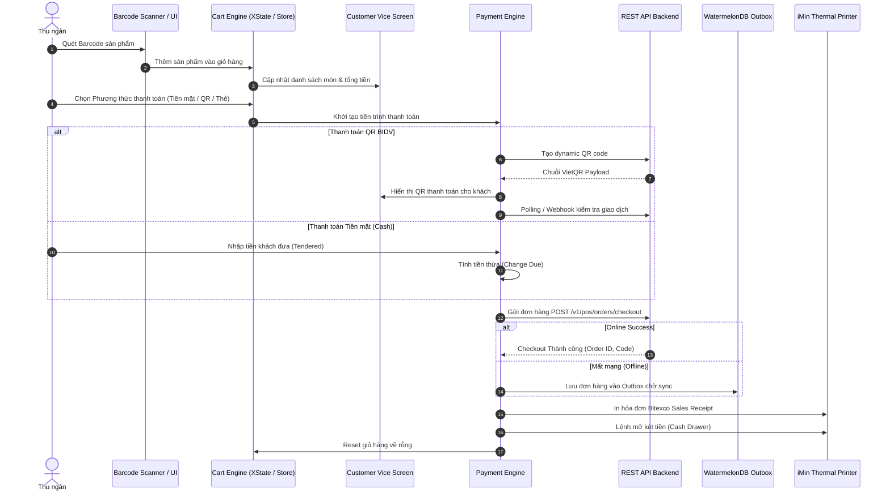

# SPEC-0001: Bán hàng, Giỏ hàng & Thanh toán Đa phương thức (POS Sales & Checkout)

Tài liệu đặc tả kiến trúc luồng bán hàng, tra cứu sản phẩm bằng barcode/search, áp voucher giảm giá, xử lý thanh toán đa phương thức và in hóa đơn tại quầy SkyStore.

---

## 🎯 Phạm vi & Ranh giới (Scope & Boundaries)

- **LÀM GÌ (In Scope):**
  - Quét mã vạch barcode (camera / máy quét phần cứng) và tìm kiếm danh mục/sản phẩm theo từ khóa.
  - Quản lý giỏ hàng: thêm, bớt, cập nhật số lượng, xóa món, tính thuế VAT và áp voucher giảm giá.
  - Thanh toán đa phương thức: Tiền mặt (Cash), QR Ngân hàng (BIDV QR động), Quẹt thẻ POS (BIDV EDC), Công nợ (Debt) hoặc Kết hợp (Mix).
  - Tự động hiển thị giỏ hàng & QR thanh toán lên màn hình phụ cho khách (Customer Vice Screen).
  - Giao tiếp máy in nhiệt iMin D4 để in hóa đơn bán lẻ (Sales Receipt) ngay khi thanh toán thành công và đẩy sự kiện mở két tiền.
- **KHÔNG LÀM GÌ (Out of Scope):**
  - Không xử lý nghiệp vụ trả/đổi hàng (xem [SPEC-0002](./0002-order-refund-exchange.md)).
  - Không quản lý chốt ca thu ngân (xem [SPEC-0003](./0003-cash-session-shift.md)).

---

## 1. Đường ống & Luồng dữ liệu (Mermaid Pipeline)



---

## 2. Bảng Cấu trúc Dữ liệu & Payloads

### 2.1 Cấu trúc Giỏ hàng & Snapshot Món (`ItemSnapshot`)

| Trường           | Kiểu dữ liệu | Ý nghĩa                                          |
| :--------------- | :----------- | :----------------------------------------------- |
| `productId`      | `string`     | ID sản phẩm / biến thể                           |
| `sku`            | `string`     | Mã SKU sản phẩm                                  |
| `name`           | `string`     | Tên sản phẩm hiển thị                            |
| `price`          | `number`     | Giá bán đơn vị (đã bao gồm thuế)                 |
| `quantity`       | `number`     | Số lượng mua                                     |
| `subtotal`       | `number`     | Thành tiền (`price * quantity - discountAmount`) |
| `taxRate`        | `number`     | Mức thuế suất VAT (VD: 8, 10)                    |
| `taxAmount`      | `number`     | Số tiền thuế VAT tương ứng                       |
| `discountAmount` | `number`     | Số tiền chiết khấu giảm giá của dòng             |

### 2.2 Payload Checkout Đơn hàng (`POST /v1/pos/orders/checkout`)

```json
{
  "idempotencyKey": "pos-checkout-1726300000-xyz",
  "cashSessionId": "01a09ee3-e256-7453-9e94-15a74b5fdf24",
  "posDeviceId": "019fb73f-6231-7247-8da0-ef981a9441f1",
  "warehouseId": "wh-001",
  "cashierUserId": "e1000000-0000-0000-0000-000000000005",
  "items": [
    {
      "variantId": "019fb740-abc-001",
      "quantity": 2,
      "price": 150000,
      "discountAmount": 0,
      "note": ""
    }
  ],
  "payments": [
    {
      "method": "CASH",
      "amount": 300000,
      "cashTendered": 500000,
      "cashChange": 200000
    }
  ],
  "voucherCode": "SKYSTORE10"
}
```

---

## 3. Giải trình Lý do Thiết kế (Design Rationale / HOW & WHY)

1. **Vì sao sử dụng Idempotency Key cho mỗi lượt thanh toán?**
   - Tránh tình trạng bấm lặp nhiều lần (double submit) hoặc mạng chập chờn gửi lại request làm trừ kho 2 lần hoặc tạo trùng đơn.
2. **Vì sao giá sản phẩm tại POS luôn là Gross Price (đã gồm VAT)?**
   - Phù hợp với chuẩn niêm yết giá bán lẻ tại quầy Bitexco Tower. Khi tính thuế, công thức bóc tách thuế là:
     $$\text{VAT} = \text{Net Price} \times \left(\frac{\text{taxRate}}{100 + \text{taxRate}}\right)$$
3. **Vì sao cần đồng thời gửi dữ liệu lên Customer Vice Screen?**
   - Thiết bị iMin POS có 2 màn hình (màn hình chính cho thu ngân, màn hình phụ hướng về khách hàng). Màn hình phụ tạo sự minh bạch khi khách theo dõi giỏ hàng và quét QR VietQR thanh toán tiện lợi.
