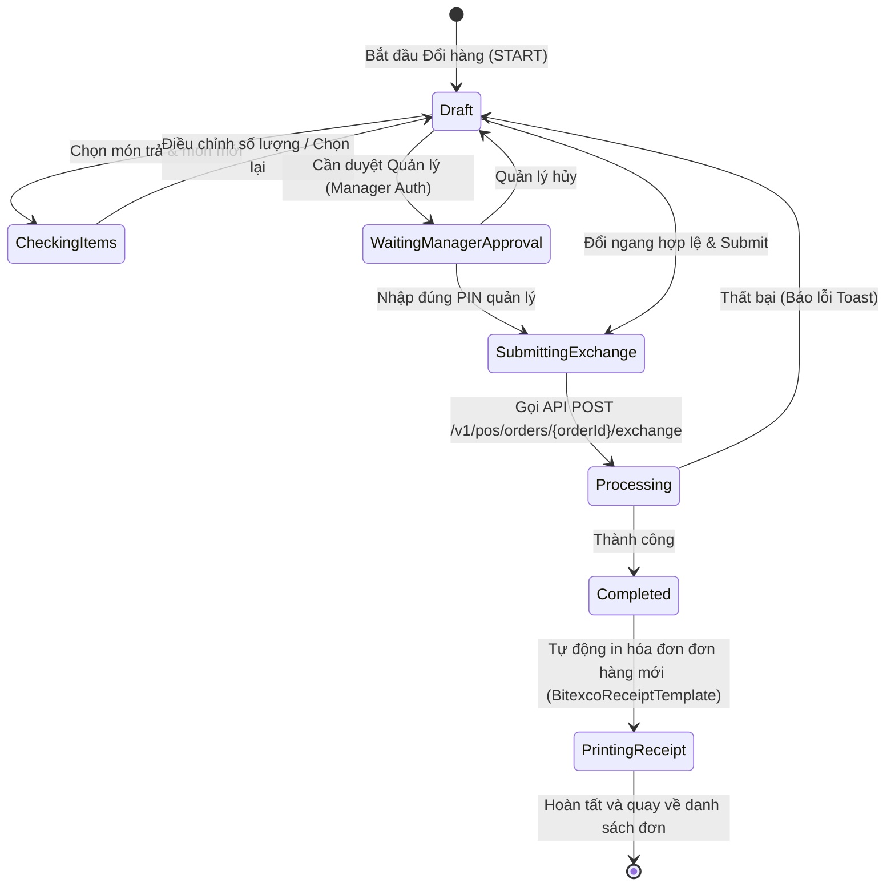

# SPEC-0002: Quản lý Đơn hàng, Trả hàng & Đổi hàng (Orders, Refund & Exchange)

Tài liệu đặc tả kiến trúc và luồng xử lý nghiệp vụ Tra cứu đơn hàng, Trả hàng (Refund) và Đổi hàng ngang giá (Equal Exchange) kèm quy tắc tạo hóa đơn mới cập nhật.

---

## 🎯 Phạm vi & Ranh giới (Scope & Boundaries)

- **LÀM GÌ (In Scope):**
  - Tra cứu lịch sử đơn hàng theo mã đơn, ngày tạo, nhân viên, phương thức thanh toán.
  - In lại hóa đơn (Reprint Receipt).
  - Trả hàng một phần hoặc toàn bộ đơn hàng (Refund Receipt).
  - Đổi hàng ngang giá (Exchange): chọn sản phẩm lỗi/cũ cần trả và chọn sản phẩm mới thay thế có cùng giá trị.
  - Tự động dựng và in **Hóa đơn đơn hàng mới hoàn chỉnh** (`EXCHANGE RECEIPT`):
    - Sản phẩm đổi hết: loại bỏ khỏi hóa đơn mới.
    - Sản phẩm đổi 1 phần: cập nhật số lượng còn lại (`quantity = originalQty - returnedQty`).
    - Sản phẩm mới thay thế: thêm vào hóa đơn với số lượng & đơn giá tương ứng.
    - Kế thừa toàn bộ thông tin gốc (Mã hóa đơn, ngày tạo, thuế VAT `totalTax`, tổng tiền `total`, thông tin thanh toán `paymentsSnapshot`).
  - Xác thực tài khoản Quản lý (Manager Approval) khi có yêu cầu phê duyệt đổi/trả.
- **KHÔNG LÀM GÌ (Out of Scope):**
  - Đổi hàng chênh lệch giá (thu thêm tiền hoặc trả lại tiền thừa) — phiên bản hiện tại chỉ áp dụng đổi ngang giá.

---

## 1. Đường ống & Luồng dữ liệu (FSM & State Flow)



---

## 2. Quy tắc Dựng Hóa đơn Đổi hàng (`saleOrder`)

Khi hoàn tất đổi hàng, ứng dụng không chỉ in danh sách sản phẩm mới đổi mà phải dựng lại toàn bộ hóa đơn của đơn hàng đã cập nhật:

### 2.1 Bảng Xử lý Dòng sản phẩm (`itemsSnapshot`)

| Trường hợp                                       | Xử lý trên Hóa đơn mới                                                                                       |
| :----------------------------------------------- | :----------------------------------------------------------------------------------------------------------- |
| **Sản phẩm cũ bị đổi hết** (`remainingQty <= 0`) | Loại bỏ hoàn toàn khỏi hóa đơn mới.                                                                          |
| **Sản phẩm cũ đổi 1 phần** (`remainingQty > 0`)  | Giữ lại trên hóa đơn với `quantity = remainingQty`, chiết khấu và thuế VAT tính theo tỷ lệ số lượng còn lại. |
| **Sản phẩm mới thay thế**                        | Thêm mới vào hóa đơn với `quantity`, `price`, `taxRate`, đánh dấu `isExchange: true`.                        |
| **Sản phẩm khác không đổi**                      | Giữ nguyên 100% thông tin.                                                                                   |

### 2.2 Payload Gọi API Đổi hàng (`POST /v1/pos/orders/{orderId}/exchange`)

```json
{
  "idempotencyKey": "exchange-1726300000-xyz",
  "reason": "Khách đổi size/mẫu khác",
  "shiftId": "01a09ee3-e256-7453-9e94-15a74b5fdf24",
  "staffId": "e1000000-0000-0000-0000-000000000005",
  "returnLines": [
    {
      "variantId": "019fb740-old-001",
      "qty": 1
    }
  ],
  "newLines": [
    {
      "variantId": "019fb740-new-002",
      "unitId": "unit-01",
      "qty": 1,
      "unitPrice": 150000,
      "discountAmount": 0,
      "taxRate": 8
    }
  ],
  "payments": [
    {
      "method": "cash",
      "amount": 150000
    }
  ],
  "managerAuth": {
    "employeeCode": "MGR001",
    "pin": "123456"
  }
}
```

---

## 3. Giải trình Lý do Thiết kế (Design Rationale / HOW & WHY)

1. **Vì sao phải in lại toàn bộ hóa đơn đơn hàng mới thay vì chỉ in món đổi?**
   - Khách hàng giữ hóa đơn làm bằng chứng mua hàng và bảo hành. Nếu chỉ in món mới, khách hàng sẽ cầm 2 mảnh hóa đơn rời rạc không thể hiện được tổng thể giao dịch đã thanh toán.
2. **Vì sao thuế VAT và tổng tiền kế thừa trực tiếp từ đơn gốc (`activeOrder`)?**
   - Đổi ngang giá bảo toàn 100% giá trị thanh toán ban đầu của đơn hàng. Việc kế thừa trực tiếp từ `activeOrder` tránh sai lệch làm tròn thuế khi tính toán lại nhiều lần ở client.
