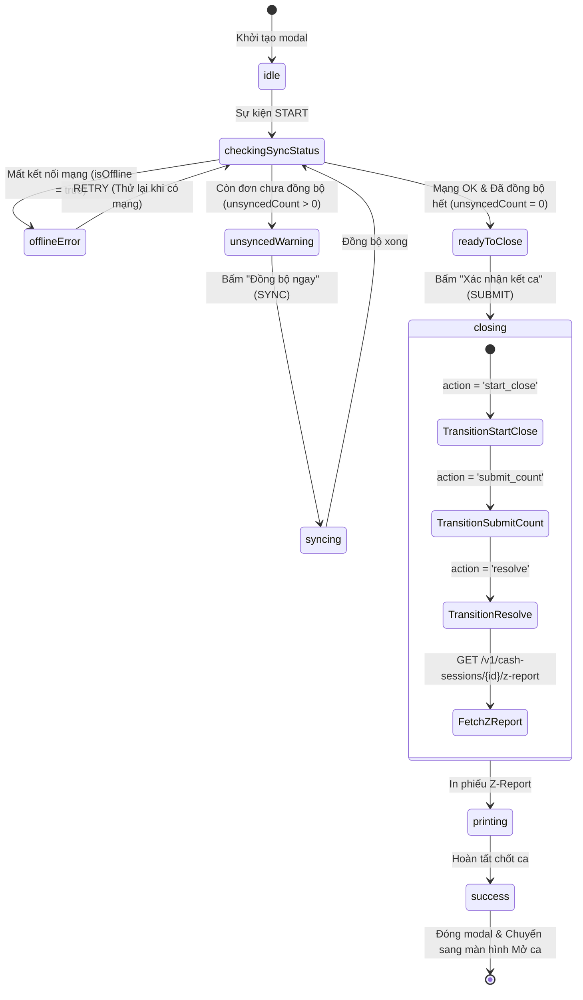

# SPEC-0003: Quản lý Ca làm việc & Báo cáo Z-Report (Cash Session & Shift Management)

Tài liệu đặc tả kiến trúc luồng Mở ca làm việc (Open Shift), Đóng ca làm việc (Close Shift), Kiểm đếm tiền mặt, Chốt ca tự động và In Báo cáo Z-Report.

---

## 🎯 Phạm vi & Ranh giới (Scope & Boundaries)

- **LÀM GÌ (In Scope):**
  - Mở ca làm việc: Nhập số tiền mặt đầu ca (Opening Cash), tạo phiên `CashSession` trên server.
  - Quản lý trạng thái ca: Kiểm tra ca đang mở của thiết bị POS (`posDeviceId`) khi khởi động ứng dụng.
  - Kiểm tra điều kiện đóng ca:
    - Bắt buộc thiết bị phải có kết nối mạng (Online).
    - Bắt buộc đồng bộ hết tất cả các đơn hàng lưu ngoại tuyến (Unsynced Orders = 0).
  - Quy trình chốt ca OCC 3 bước (`start_close` $\rightarrow$ `submit_count` $\rightarrow$ `resolve`).
  - Tự động gán số tiền kết ca bàn giao bằng số tiền dự kiến thực tế (`actualEndingCash = expectedEndingCash`), không yêu cầu cashier chỉnh sửa số tiền thực tế hay lý do chênh lệch.
  - Tải dữ liệu Báo cáo Z-Report và in phiếu tổng kết ca (`Z-Report Receipt`) qua máy in nhiệt.
  - Chuẩn hóa hiển thị thời gian vào ca theo múi giờ địa phương (GMT+7).
- **KHÔNG LÀM GÌ (Out of Scope):**
  - Không cho phép bán hàng khi chưa mở ca.

---

## 1. Đường ống & Luồng dữ liệu (XState Machine Close Shift)



---

## 2. Bảng Cấu trúc Dữ liệu & Payloads

### 2.1 Cấu trúc Phiên Ca (`CashSession`)

| Trường          | Kiểu dữ liệu | Ý nghĩa                                                 |
| :-------------- | :----------- | :------------------------------------------------------ |
| `id`            | `string`     | UUID phiên ca làm việc                                  |
| `code`          | `string`     | Mã ca (VD: `CS-14092026-00001`)                         |
| `posDeviceId`   | `string`     | ID thiết bị POS                                         |
| `cashierUserId` | `string`     | ID thu ngân mở ca                                       |
| `state`         | `string`     | Trạng thái (`OPEN`, `CLOSING`, `RECONCILING`, `CLOSED`) |
| `openingCash`   | `number`     | Số tiền mặt mở ca                                       |
| `countedCash`   | `number`     | Số tiền mặt kiểm đếm khi đóng ca                        |
| `expectedCash`  | `number`     | Số tiền mặt dự kiến hệ thống ghi nhận                   |
| `openedAt`      | `string`     | Thời điểm mở ca (ISO UTC format)                        |
| `closedAt`      | `string`     | Thời điểm đóng ca (ISO UTC format)                      |
| `version`       | `number`     | Phiên bản OCC kiểm soát đồng thời                       |

### 2.2 Cấu trúc Báo cáo Z-Report (`ZReportResponse`)

```json
{
  "session": {
    "id": "01a09ee3-e256-7453-9e94-15a74b5fdf24",
    "code": "CS-14092026-00001",
    "openedAt": "2026-09-14T07:48:49.879Z",
    "closedAt": "2026-09-14T15:30:00.000Z",
    "openingCash": 5000000,
    "countedCash": 9088000,
    "expectedCash": 9088000
  },
  "posDeviceName": "POS SkyStore 01",
  "orderCount": 15,
  "paymentBreakdown": [
    { "method": "cash", "amount": 4088000 },
    { "method": "qr_bidv", "amount": 2500000 },
    { "method": "card_bidv", "amount": 1200000 }
  ],
  "staffs": [
    {
      "staffName": "Nguyễn Văn A",
      "staffCode": "NV01",
      "orderCount": 10,
      "cashAmount": 3000000,
      "qrAmount": 2000000,
      "cardAmount": 1000000,
      "totalRevenue": 6000000
    }
  ]
}
```

---

## 3. Giải trình Lý do Thiết kế (Design Rationale / HOW & WHY)

1. **Vì sao tự động khóa số tiền kết ca thay vì cho cashier chỉnh sửa?**
   - Nghiệp vụ chốt ca tại Bitexco yêu cầu số liệu tài chính trên hệ thống phải khớp 100% với doanh thu ghi nhận. Mọi khoản chênh lệch tiền lẻ phát sinh được nhân viên tự bù/đối soát ngoài thực tế, giúp quy trình chốt ca nhanh chóng và giảm thiểu sai sót do nhập tay.
2. **Xử lý Múi giờ UTC vs Local GMT+7 như thế nào?**
   - Server luôn lưu trữ và trả về thời gian chuẩn ISO UTC (`"2026-09-14T07:48:49.879Z"`).
   - Client sử dụng helper `formatShiftStartDisplay()` và `formatDateTime()` để luôn convert chuẩn xác sang múi giờ `+07:00` của Việt Nam trước khi hiển thị trên giao diện và in hóa đơn.
