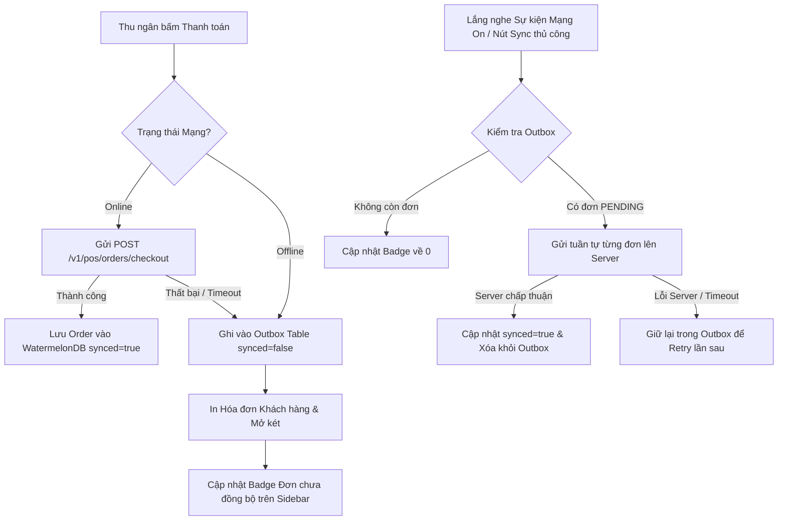

# SPEC-0004: Động cơ Lưu trữ Cục bộ & Đồng bộ Ngoại tuyến (Offline-First Outbox Sync Engine)

Tài liệu đặc tả kiến trúc lưu trữ cơ sở dữ liệu cục bộ SQLite (WatermelonDB) và động cơ Outbox tự động đồng bộ đơn hàng khi thiết bị mất mạng.

---

## 🎯 Phạm vi & Ranh giới (Scope & Boundaries)

- **LÀM GÌ (In Scope):**
  - Lưu trữ offline danh mục sản phẩm, bảng giá, ca làm việc và danh sách đơn hàng vào WatermelonDB.
  - Khi thiết bị mất mạng (Offline), đơn hàng mới tạo được đẩy vào bảng `outbox` với trạng thái `PENDING`.
  - Tự động theo dõi trạng thái mạng (`NetInfo`). Khi có kết nối trở lại, kích hoạt `SyncService.drainOutbox()` để đẩy các đơn hàng đang chờ lên Server.
  - Hiển thị huy hiệu số lượng đơn chưa đồng bộ (Badge Count) trên thanh công cụ Sidebar.
  - Cơ chế Re-try và bảo toàn dữ liệu khi có lỗi xảy ra trong quá trình đồng bộ.
- **KHÔNG LÀM GÌ (Out of Scope):**
  - Không cho phép thực hiện chốt ca (Close Shift) khi còn đơn hàng chưa đồng bộ trong Outbox.

---

## 1. Đường ống & Luồng dữ liệu (Offline Outbox Sync Pipeline)

---

## 2. Bảng Cấu trúc Dữ liệu Outbox (`outbox_records`)

| Trường            | Kiểu dữ liệu    | Ý nghĩa                                        |
| :---------------- | :-------------- | :--------------------------------------------- |
| `id`              | `string` (UUID) | Khóa chính của bản ghi outbox                  |
| `entity_type`     | `string`        | Loại dữ liệu (`order`, `shift_action`, `note`) |
| `action`          | `string`        | Hành động (`CREATE`, `UPDATE`, `TRANSITION`)   |
| `payload`         | `string` (JSON) | Dữ liệu đầy đủ của request cần đồng bộ         |
| `idempotency_key` | `string`        | Khóa chống trùng lặp request khi retry         |
| `status`          | `string`        | `PENDING`, `SYNCING`, `FAILED`                 |
| `retry_count`     | `number`        | Số lần đã thử gửi lại                          |
| `created_at`      | `number`        | Thời điểm tạo bản ghi cục bộ                   |

---

## 3. Giải trình Lý do Thiết kế (Design Rationale / HOW & WHY)

1. **Vì sao chọn mô hình Outbox Pattern trên WatermelonDB SQLite?**
   - Đảm bảo tính sẵn sàng (High Availability) cao nhất cho quầy bán vé & lưu niệm tại Bitexco. Thu ngân vẫn có thể bán hàng, in hóa đơn và mở két bình thường kể cả khi mạng tòa nhà gặp sự cố.
2. **Xử lý tránh trùng đơn hàng khi Retry như thế nào?**
   - Mỗi bản ghi Outbox luôn mang theo một `idempotencyKey` bất biến được tạo ngay từ lúc cashier bấm thanh toán. Khi Backend nhận request retry, Backend sẽ dùng key này để nhận diện và không tạo đơn hàng thứ 2.
