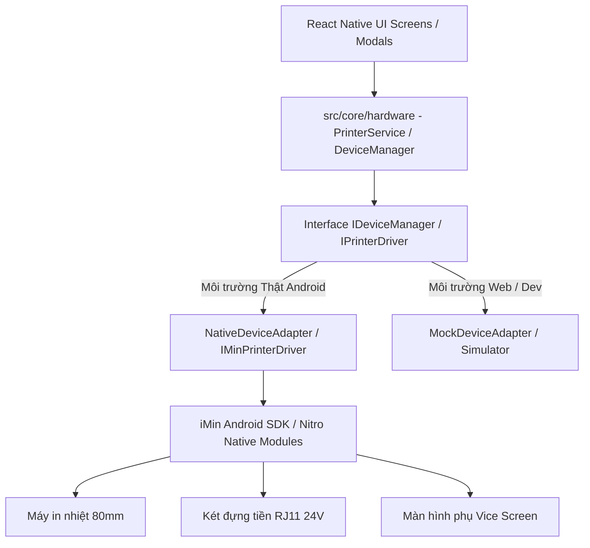

# SPEC-0005: Lớp Trừu tượng hóa Phần cứng (Hardware Abstraction Layer - HAL)

Tài liệu đặc tả kiến trúc tầng giao tiếp phần cứng (HAL) tại `src/core/hardware/` cho thiết bị **iMin POS Android** (Máy in nhiệt tích hợp, Két tiền tự động, Màn hình phụ tương tác khách hàng và Đầu đọc mã vạch).

---

## 🎯 Phạm vi & Ranh giới (Scope & Boundaries)

- **LÀM GÌ (In Scope):**
  - Cung cấp giao diện chuẩn (`IHardwareService` / `PrinterService` / `IMinPrinterDriver`) độc lập với UI.
  - Hỗ trợ 2 bộ Driver:
    - `NativeDriver`: chạy trên máy thật Android iMin POS (gọi native SDK).
    - `MockDriver`: chạy trên môi trường Web / Simulator / Development (giả lập thành công không gây crash).
  - Điều khiển máy in nhiệt 80mm: In hóa đơn bán hàng, hóa đơn đổi hàng, phiếu trả tiền, báo cáo Z-Report, căn chỉnh lề, in logo bitmap, cắt giấy tự động.
  - Điều khiển mở két tiền (Cash Drawer / Cashbox): Bắn xung điện 24V mở két khi thanh toán tiền mặt hoặc bấm nút "Mở két" trên Sidebar.
  - Điều khiển Màn hình phụ (Vice Screen): Hiển thị giỏ hàng, thông tin thanh toán, QR động VietQR và video/banner quảng cáo SkyStore khi nhàn rỗi.
  - Nhận diện máy quét mã vạch Barcode phần cứng và USB/HID Scanner.
- **KHÔNG LÀM GÌ (Out of Scope):**
  - Không nhúng mã gọi Native Module trực tiếp vào các React UI Components.

---

## 1. Kiến trúc Giao tiếp Phần cứng (HAL Architecture)



---

## 2. Danh mục Giao diện Cốt lõi (`Hardware Ports`)

```typescript
// src/core/hardware/types.ts

export interface IPrinterService {
  /** In một React Component thông qua react-native-view-shot */
  printComponent(ref: React.RefObject<any>, options?: PrintOptions): Promise<void>
  /** Gửi lệnh xung mở két tiền */
  openCashBox(): Promise<void>
  /** Cắt giấy tự động */
  cutPaper(): Promise<void>
  /** Kiểm tra trạng thái máy in (Hết giấy, kẹt giấy, nắp mở) */
  getPrinterStatus(): Promise<PrinterStatus>
}

export interface IViceScreenManager {
  /** Hiển thị giỏ hàng lên màn hình phụ */
  showCart(items: ItemSnapshot[], total: number): Promise<void>
  /** Hiển thị mã QR thanh toán */
  showQR(qrData: string, amount: number): Promise<void>
  /** Chuyển về màn hình chào/quảng cáo */
  showWelcome(): Promise<void>
}
```

---

## 3. Giải trình Lý do Thiết kế (Design Rationale / HOW & WHY)

1. **Vì sao bắt buộc sử dụng lớp HAL thay vì gọi thẳng Native Module trong Screen?**
   - Đảm bảo mã nguồn UI sạch sẽ, tuân thủ nguyên tắc Clean Architecture. Đồng thời cho phép lập trình viên phát triển và kiểm thử giao diện trơn tru trên Simulator/Web mà không bị lỗi crash do thiếu phần cứng thật.
2. **Cơ chế in Component React Native (ViewShot Bitmap vs Text ESC/POS):**
   - Ứng dụng sử dụng kỹ thuật chụp ảnh chất lượng cao component React Native (`BitexcoReceiptTemplate`, `CloseShiftReceiptTemplate`) và gửi dữ liệu raster bitmap sang máy in iMin. Cách này giúp hóa đơn hiển thị sắc nét, căn chỉnh lề chính xác, hỗ trợ đầy đủ font tiếng Việt có dấu và logo đồ họa mà không bị lỗi font của lệnh ESC/POS truyền thống.
