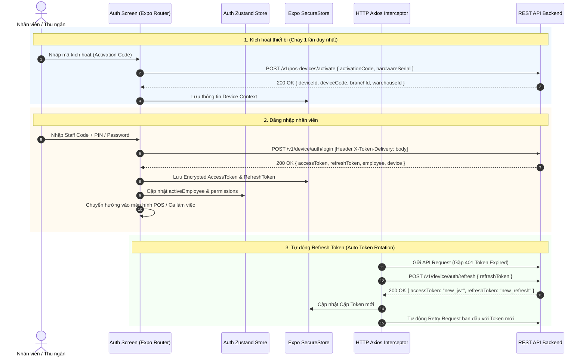

# SPEC-0006: Kích hoạt Thiết bị, Xác thực Nhân viên & Quản lý Phiên (Device Activation, Staff Auth & Session Lifecycle)

Tài liệu đặc tả kiến trúc luồng Kích hoạt máy POS (Device Activation), Đăng nhập nhân viên thu ngân (Staff Login), Xoay vòng Token bảo mật (Refresh Token Rotation), Phân quyền người dùng (RBAC) và Đăng xuất phiên làm việc.

---

## 🎯 Phạm vi & Ranh giới (Scope & Boundaries)

- **LÀM GÌ (In Scope):**
  - Kích hoạt thiết bị POS lần đầu bằng mã kích hoạt `activationCode` hoặc quét mã QR thiết bị (`POST /v1/pos-devices/activate`).
  - Đăng nhập nhân viên thu ngân bằng mã nhân viên và mật khẩu / mã PIN (`POST /v1/device/auth/login`).
  - Quản lý phiên làm việc & Tự động xoay vòng Access Token / Refresh Token tuân thủ ADR-0022 (`POST /v1/device/auth/refresh` với header `X-Token-Delivery: body`).
  - Tự động thu hồi phiên (Revoke Token) khi đăng xuất (`POST /v1/device/auth/logout`).
  - Lưu trữ định danh thiết bị (`posDeviceId`, `deviceCode`) an toàn trong SecureStore và local SQLite.
  - Phân quyền nhân viên (Thu ngân vs Quản lý ca) theo danh sách permissions trong payload JWT/Session (`print:shift`, `order:refund`, `order:exchange`, `order:cancel`).
- **KHÔNG LÀM GÌ (Out of Scope):**
  - Không quản lý nghiệp vụ tiền mặt trong ca làm việc (xem [SPEC-0003](./0003-cash-session-shift.md)).
  - Không quản lý chi tiết phê duyệt Manager PIN override (xem [SPEC-0011](./0011-manager-override-security.md)).

---

## 1. Đường ống & Luồng dữ liệu (Authentication Sequence & Lifecycle)



---

## 2. Bảng Cấu trúc Dữ liệu & API Payloads

### 2.1 Kích hoạt Thiết bị POS (`POST /v1/pos-devices/activate`)

#### Request:

```json
{
  "activationCode": "ACT-SKYSTORE-8899",
  "deviceSerial": "IMIN-D4-2026X001",
  "deviceName": "POS Quầy Tầng 49 - Bitexco"
}
```

#### Response:

```json
{
  "id": "019fb73f-6231-7247-8da0-ef981a9441f1",
  "deviceCode": "POS-SKY-01",
  "name": "POS Quầy Tầng 49 - Bitexco",
  "warehouseId": "019fb73f-7777-7247-8da0-ef981a9441aa",
  "branchId": "019fb73f-8888-7247-8da0-ef981a9441bb",
  "status": "ACTIVE"
}
```

### 2.2 Đăng nhập Nhân viên (`POST /v1/device/auth/login`)

#### Header bắt buộc:

- `X-Token-Delivery: body` (Quy định tại ADR-0022 để React Native nhận token trong JSON body thay vì cookie trình duyệt)

#### Request:

```json
{
  "username": "cashier01",
  "password": "Password@123",
  "deviceId": "019fb73f-6231-7247-8da0-ef981a9441f1"
}
```

#### Response:

```json
{
  "accessToken": "eyJhbGciOiJIUzI1NiIsInR5cCI6IkpXVCJ9...",
  "refreshToken": "7c9e6679-7425-40de-944b-e07fc1f90ae7",
  "expiresIn": 3600,
  "employee": {
    "id": "e1000000-0000-0000-0000-000000000005",
    "employeeCode": "NV005",
    "name": "Trần Thị Mai",
    "role": "CASHIER",
    "permissions": ["pos:checkout", "shift:open", "shift:close", "print:shift"]
  },
  "device": {
    "id": "019fb73f-6231-7247-8da0-ef981a9441f1",
    "deviceCode": "POS-SKY-01"
  }
}
```

---

## 3. Giải trình Lý do Thiết kế (Design Rationale / HOW & WHY)

1. **Vì sao bắt buộc sử dụng Header `X-Token-Delivery: body` (ADR-0022)?**
   - Môi trường Mobile (React Native / Android) không quản lý Cookie tự động như trình duyệt Web. Header này báo hiệu cho Backend trả trực tiếp `refreshToken` trong payload response để app lưu vào SecureStore an toàn.
2. **Cơ chế Refresh Token Rotation hoạt động thế nào để chống Replay Attack?**
   - Mỗi lần gọi endpoint `/v1/device/auth/refresh`, Backend lập tức hủy bỏ (revoke) `refreshToken` cũ và phát hành một cặp `accessToken` + `refreshToken` hoàn toàn mới.
   - Nếu phát hiện kẻ gian cố tình dùng lại `refreshToken` đã bị hủy, server sẽ vô hiệu hóa toàn bộ chuỗi token của thiết bị đó ngay lập tức (Security breach mitigation).
3. **Vì sao thiết bị POS cần kích hoạt độc lập với tài khoản nhân viên?**
   - Thiết bị POS là tài sản phần cứng gắn với quầy vật lý và kho hàng tại SkyStore Bitexco. Nhân viên có thể đổi ca, luân chuyển quầy đăng nhập trên cùng một máy mà không làm thay đổi ánh xạ phần cứng (`posDeviceId`, `warehouseId`).
