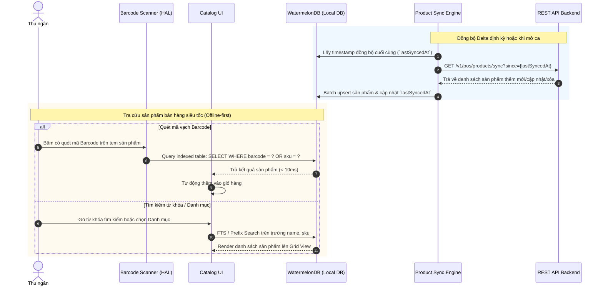

# SPEC-0007: Danh mục Sản phẩm, Tìm kiếm Nhanh & Đồng bộ Delta (Product Catalog, Delta Sync & Barcode Lookup)

Tài liệu đặc tả kiến trúc lưu trữ sản phẩm cục bộ, cơ chế đồng bộ biến động danh mục (Delta Sync), tra cứu siêu tốc qua mã vạch (Barcode/SKU) và phân loại danh mục hàng lưu niệm Bitexco SkyStore.

---

## 🎯 Phạm vi & Ranh giới (Scope & Boundaries)

- **LÀM GÌ (In Scope):**
  - Quản lý danh mục sản phẩm (Category) và biến thể hàng hóa (Product Variants / Units).
  - Đồng bộ danh mục sản phẩm theo cơ chế Delta Sync (`GET /v1/pos/products/sync?since=...`) để giảm tải băng thông và nạp dữ liệu nhanh khi mở app.
  - Lưu trữ và lập chỉ mục (Indexing) danh mục hàng hóa trong cơ sở dữ liệu SQLite cục bộ (WatermelonDB).
  - Tra cứu siêu tốc sản phẩm bằng Barcode Scanner phần cứng (HAL Barcode) hoặc gõ tìm kiếm theo SKU / Tên món.
  - Tra cứu thông tin sản phẩm trực tiếp từ server khi đổi hàng hoặc khi sản phẩm chưa kịp đồng bộ cục bộ (`GET /v1/pos/products/lookup`).
  - Hỗ trợ đa đơn vị tính (`unitId`, `unitCode`), thuế suất VAT (`taxRate`) và tồn kho khả dụng (`stock`).
- **KHÔNG LÀM GÌ (Out of Scope):**
  - Không tạo/sửa thông tin sản phẩm trên máy POS (nghiệp vụ quản lý thuộc về WMS/Backoffice).

---

## 1. Đường ống & Luồng dữ liệu (Delta Sync & Search Pipeline)



---

## 2. Bảng Cấu trúc Dữ liệu & API Payloads

### 2.1 Bảng Cục bộ `products` trong SQLite (WatermelonDB)

| Cột             | Kiểu          | Mô tả                                             |
| :-------------- | :------------ | :------------------------------------------------ |
| `id`            | `string` (PK) | Variant ID sản phẩm                               |
| `category_id`   | `string`      | ID danh mục phân loại                             |
| `category_name` | `string`      | Tên danh mục (Móc khóa, Áo thun, Quà lưu niệm...) |
| `sku`           | `string`      | Mã SKU định danh                                  |
| `barcode`       | `string`      | Mã vạch in trên tem                               |
| `name`          | `string`      | Tên sản phẩm                                      |
| `price`         | `number`      | Giá bán lẻ niêm yết (đã bao gồm thuế)             |
| `stock`         | `number`      | Số lượng tồn kho tức thời                         |
| `unit_id`       | `string`      | ID đơn vị tính                                    |
| `unit_code`     | `string`      | Mã đơn vị (Cái, Chiếc, Bộ, Hộp...)                |
| `tax_rate`      | `number`      | Thuế suất VAT (0.08, 0.10)                        |
| `image_url`     | `string`      | Đường dẫn ảnh đại diện sản phẩm                   |
| `updated_at`    | `number`      | Unix timestamp cập nhật                           |

### 2.2 Payload Đồng bộ Delta (`GET /v1/pos/products/sync?since=2026-09-14T00:00:00.000Z`)

#### Response:

```json
{
  "syncedAt": "2026-09-14T10:00:00.000Z",
  "products": [
    {
      "id": "019fb740-abc-001",
      "categoryId": "cat-001",
      "categoryName": "Mô hình & Quà lưu niệm",
      "sku": "MK-BITEXCO-3D",
      "barcode": "8938501234567",
      "name": "Móc khóa Tháp Bitexco 3D Kim Loại",
      "price": 85000,
      "stock": 120,
      "unitId": "unit-01",
      "unitCode": "Cái",
      "taxRate": 0.08,
      "imageUrl": "https://cdn.bitexco.com.vn/products/mk3d.png",
      "isDeleted": false,
      "updatedAt": "2026-09-14T09:45:00.000Z"
    }
  ],
  "categories": [
    {
      "id": "cat-001",
      "name": "Mô hình & Quà lưu niệm",
      "displayOrder": 1
    }
  ]
}
```

---

## 3. Giải trình Lý do Thiết kế (Design Rationale / HOW & WHY)

1. **Vì sao sử dụng cơ chế Delta Sync thay vì Full Sync mỗi lần tải?**
   - Danh mục sản phẩm tại SkyStore có hàng nghìn mặt hàng. Delta sync chỉ truyền các bản ghi có `updatedAt > since`, giảm đến 95% dung lượng truyền tải mạng và giúp khởi động ứng dụng tức thì.
2. **Vì sao phải index cột `barcode` và `sku` trong SQLite cục bộ?**
   - Thu ngân quét mã vạch bằng máy quét phần cứng với tốc độ cao (nhiều lần quét mỗi giây). Việc index giúp câu truy vấn nội bộ hoàn tất dưới 10ms, không gây hiện tượng trễ khi đưa món vào giỏ hàng.
3. **Xử lý thế nào khi sản phẩm bị xóa khỏi hệ thống?**
   - API trả cờ `isDeleted: true`. Sync Engine cục bộ sẽ thực hiện soft-delete hoặc xóa bản ghi tương ứng khỏi SQLite để không còn hiển thị trên quầy bán hàng.
