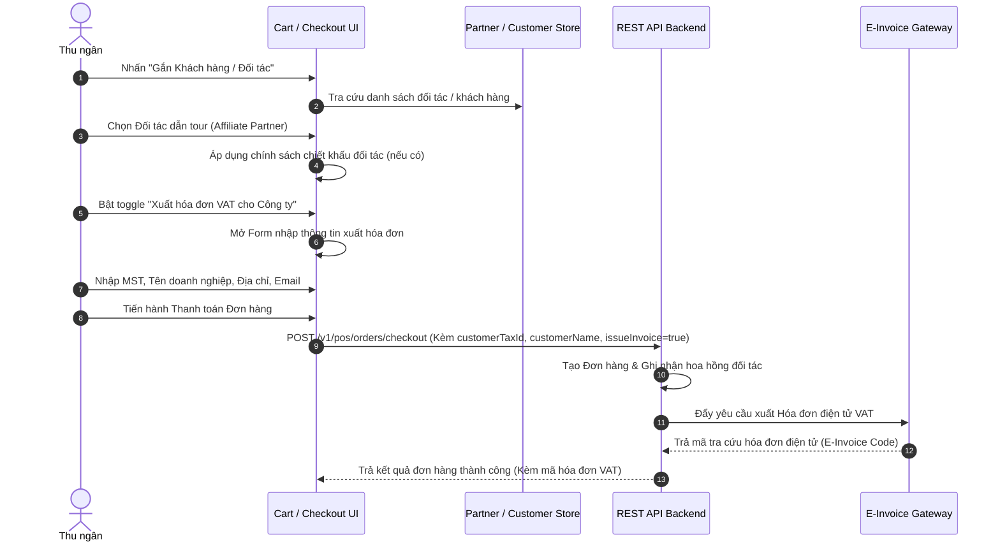

# SPEC-0008: Quản lý Khách hàng, Đối tác & Hóa đơn Điện tử VAT (Customer, Partner/Affiliate & E-Invoice Integration)

Tài liệu đặc tả kiến trúc luồng gắn thông tin Khách hàng thành viên, ghi nhận Đối tác tiếp thị liên kết (Partner/Affiliate) và thu thập thông tin xuất Hóa đơn điện tử VAT trực tiếp tại quầy POS Bitexco SkyStore.

---

## 🎯 Phạm vi & Ranh giới (Scope & Boundaries)

- **LÀM GÌ (In Scope):**
  - Tìm kiếm và chọn Khách hàng thành viên theo Số điện thoại / Tên / Mã khách hàng.
  - Tích hợp đối tác tiếp thị liên kết (Partner / Tour guide / Affiliate) nhằm tính toán hoa hồng hoặc chiết khấu đoàn khách du lịch.
  - Đồng bộ danh sách đối tác và biến động đối tác định kỳ (`GET /v1/pos/partners`, `GET /v1/pos/affiliates`).
  - Thu thập thông tin xuất Hóa đơn điện tử VAT (E-Invoice):
    - Cờ yêu cầu xuất hóa đơn (`issueInvoice: boolean`).
    - Tên công ty / Đơn vị mua hàng (`customerName`).
    - Mã số thuế doanh nghiệp (`customerTaxId`).
    - Địa chỉ xuất hóa đơn (`customerAddress`).
    - Email nhận hóa đơn điện tử (`customerEmail`).
  - Truyền đầy đủ dữ liệu thuế và thông tin khách hàng vào payload đơn hàng thanh toán để Backend kích hoạt dịch vụ phát hành E-Invoice.
- **KHÔNG LÀM GÌ (Out of Scope):**
  - Không tự ký số hay sinh file XML hóa đơn tại thiết bị POS (việc ký số và gửi Cơ quan Thuế do Backend E-Invoice Gateway thực hiện).

---

## 1. Đường ống & Luồng dữ liệu (Customer & Invoice Flow)



---

## 2. Bảng Cấu trúc Dữ liệu & Payloads

### 2.1 Cấu trúc Thông tin Đối tác (`Partner / Affiliate`)

| Trường           | Kiểu dữ liệu | Ý nghĩa                                 |
| :--------------- | :----------- | :-------------------------------------- |
| `id`             | `string`     | UUID đối tác                            |
| `code`           | `string`     | Mã đối tác (VD: `TOUR-SAIGONTRAVEL-01`) |
| `name`           | `string`     | Tên hướng dẫn viên / Công ty du lịch    |
| `phone`          | `string`     | Số điện thoại liên hệ                   |
| `commissionRate` | `number`     | Tỷ lệ hoa hồng (%)                      |
| `status`         | `string`     | `ACTIVE`, `INACTIVE`                    |

### 2.2 Payload Dữ liệu Khách hàng & Hóa đơn trong Checkout

```json
{
  "customerId": "019fb740-cust-001",
  "partnerId": "019fb740-part-002",
  "affiliateCode": "GUIDE-QUAN-09",
  "issueInvoice": true,
  "customerName": "CÔNG TY TNHH DU LỊCH VÀ DỊCH VỤ BITEXCO",
  "customerTaxId": "0301234567",
  "customerAddress": "Tầng 49, Bitexco Financial Tower, 2 Hải Triều, Q.1, TP.HCM",
  "customerEmail": "accounting@tourcompany.vn"
}
```

---

## 3. Giải trình Lý do Thiết kế (Design Rationale / HOW & WHY)

1. **Vì sao thông tin hóa đơn VAT được gửi trực tiếp cùng payload Checkout?**
   - Đảm bảo tính toàn vẹn và nguyên tử (Atomic transaction). Việc xuất hóa đơn gắn liền với đơn hàng ngay tại thời điểm thanh toán tránh trường hợp đơn hàng đã tạo nhưng thông tin xuất hóa đơn bị thất lạc.
2. **Xử lý thế nào với khách hàng mua lẻ không lấy hóa đơn?**
   - Mặc định `issueInvoice = false` và các trường `customerTaxId`, `customerAddress` để `null`. Hóa đơn in ra quầy là Hóa đơn bán lẻ thông thường (Sales Receipt).
3. **Cơ chế lưu trữ danh sách đối tác cục bộ?**
   - Danh sách đối tác lữ hành được đồng bộ định kỳ vào SQLite để thu ngân có thể chọn nhanh hướng dẫn viên ngay cả khi đường truyền internet tạm thời bị chập chờn.
