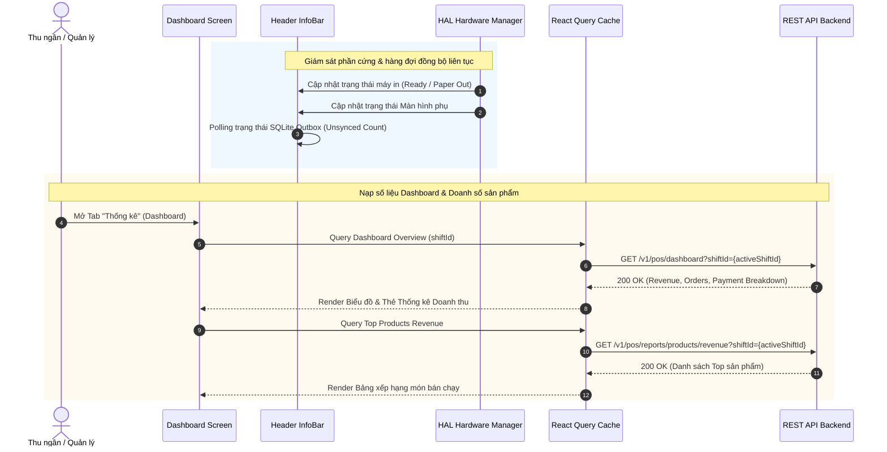

# SPEC-0009: Bảng điều khiển Thời gian thực & Giám sát Quầy (Realtime Dashboard & Cashier Info Bar)

Tài liệu đặc tả kiến trúc Bảng điều khiển Thống kê Doanh thu (Realtime Dashboard), Báo cáo Top Sản phẩm bán chạy và Thanh Trạng thái Hệ thống (Info Bar) phục vụ giám sát vận hành quầy POS SkyStore Bitexco.

---

## 🎯 Phạm vi & Ranh giới (Scope & Boundaries)

- **LÀM GÌ (In Scope):**
  - Hiển thị các chỉ số kinh doanh then chốt (KPIs) của ca hiện tại theo thời gian thực:
    - Tổng doanh thu ca (`totalRevenue`).
    - Tổng số đơn hàng (`totalOrders`).
    - Giá trị trung bình mỗi đơn (`averageOrderValue`).
    - Cơ cấu doanh thu theo từng phương thức thanh toán (Tiền mặt, QR BIDV, Quẹt thẻ EDC).
  - Báo cáo chi tiết doanh thu theo từng mặt hàng / danh mục bán chạy (`GET /v1/pos/reports/products/revenue`).
  - Thanh trạng thái hệ thống (`InfoBar`):
    - Trạng thái kết nối mạng (Online / Offline).
    - Mã phiên ca làm việc hiện tại và thời gian mở ca (Uptime).
    - Số lượng đơn hàng ngoại tuyến đang chờ đồng bộ (`unsyncedCount`).
    - Tên và mã nhân viên thu ngân đang đăng nhập.
    - Trạng thái kết nối thiết bị ngoại vi: Máy in nhiệt (Printer Connected), Màn hình phụ (Vice Screen Ready).
- **KHÔNG LÀM GÌ (Out of Scope):**
  - Không thay thế báo cáo tài chính tổng hợp toàn chuỗi (dữ liệu này thuộc về Backoffice BI).

---

## 1. Đường ống & Luồng dữ liệu (Dashboard Metric Stream)



---

## 2. Bảng Cấu trúc Dữ liệu & Payloads

### 2.1 Cấu trúc Tổng quan Dashboard (`GET /v1/pos/dashboard?shiftId=...`)

```json
{
  "shiftId": "01a09ee3-e256-7453-9e94-15a74b5fdf24",
  "shiftCode": "CS-14092026-00001",
  "openedAt": "2026-09-14T07:48:49.879Z",
  "totalRevenue": 8788000,
  "totalOrders": 24,
  "averageOrderValue": 366166,
  "totalDiscount": 250000,
  "paymentBreakdown": {
    "cash": 4088000,
    "qr_bidv": 3200000,
    "card_bidv": 1500000
  }
}
```

### 2.2 Cấu trúc Báo cáo Doanh thu Sản phẩm (`GET /v1/pos/reports/products/revenue`)

```json
{
  "items": [
    {
      "productId": "019fb740-abc-001",
      "sku": "MK-BITEXCO-3D",
      "productName": "Móc khóa Tháp Bitexco 3D",
      "quantitySold": 35,
      "totalRevenue": 2975000,
      "percentage": 33.8
    },
    {
      "productId": "019fb740-abc-002",
      "sku": "AT-SKY-01",
      "productName": "Áo thun SkyStore Saigon Skyline (Size L)",
      "quantitySold": 12,
      "totalRevenue": 3000000,
      "percentage": 34.1
    }
  ]
}
```

---

## 3. Giải trình Lý do Thiết kế (Design Rationale / HOW & WHY)

1. **Vì sao Dashboard lấy số liệu đã tính sẵn từ Server thay vì Client tự tính từ SQLite?**
   - Server là Single Source of Truth cho toàn bộ giao dịch trực tuyến. Việc Server tính toán sẵn đảm bảo số liệu chính xác tuyệt đối, bao gồm cả các giao dịch thanh toán QR/thẻ được xác nhận qua Webhook.
2. **Cơ chế hoạt động của Info Bar khi mất mạng?**
   - Info Bar lập tức chuyển badge sang màu cam/đỏ (`Mất kết nối`), hiển thị số lượng đơn hàng chưa đồng bộ trong Outbox (`⚠️ 3 đơn chưa sync`), giúp thu ngân luôn chủ động nắm bắt tình trạng thiết bị trước khi thực hiện đóng ca.
