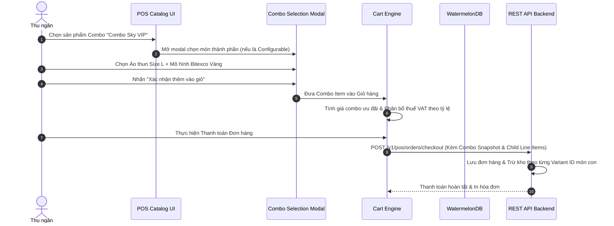

# SPEC-0010: Quản lý Combo & Khuyến mãi Đóng gói (Combo Bundles & Promotional Engine)

Tài liệu đặc tả kiến trúc cấu hình gói sản phẩm Combo (Combo Bundles), cơ chế bóc tách trừ tồn kho linh kiện con (Child Components Inventory Deduction) và lưu trữ Snapshot trong hóa đơn bán lẻ tại Bitexco SkyStore.

---

## 🎯 Phạm vi & Ranh giới (Scope & Boundaries)

- **LÀM GÌ (In Scope):**
  - Quản lý 2 dạng gói combo lưu niệm:
    - **Combo Cố định (Fixed Combo)**: Gói quà bao gồm các sản phẩm thành phần cố định (VD: Gói Quà Lưu Niệm SkyStore = 1 Mô hình 3D + 1 Móc khóa + 1 Nón du lịch).
    - **Combo Tùy chọn (Configurable Combo)**: Gói sản phẩm cho phép khách hàng chọn phân loại/size/màu sắc cho từng nhóm thành phần (VD: Chọn 1 Áo thun bất kỳ Size S/M/L + 1 Ly sứ bất kỳ).
  - Tự động áp dụng giá bán ưu đãi của gói Combo thay vì tổng giá lẻ.
  - Phân bổ giá trị và thuế VAT hợp lệ cho từng thành phần con trong gói để phục vụ trừ kho chính xác tại WMS.
  - Lưu trữ cấu trúc Snapshot Combo trong đơn hàng (`itemsSnapshot`) để in hóa đơn rõ ràng (Tên gói combo kèm danh sách món con kèm theo).
- **KHÔNG LÀM GÌ (Out of Scope):**
  - Không cho phép tách lẻ 1 món trong combo để trả hàng lấy lại tiền (đổi/trả combo áp dụng cho nguyên bộ hoặc đổi size cùng loại).

---

## 1. Đường ống & Luồng dữ liệu (Combo Cart Pipeline)



---

## 2. Bảng Cấu trúc Dữ liệu & Payloads

### 2.1 Cấu trúc Snapshot Combo trong Giỏ hàng (`ComboItemSnapshot`)

```json
{
  "comboId": "019fb740-combo-001",
  "comboCode": "CB-SKY-VIP",
  "comboName": "Combo Quà Tặng SkyStore VIP",
  "comboPrice": 450000,
  "originalPrice": 520000,
  "discountAmount": 70000,
  "quantity": 1,
  "components": [
    {
      "productId": "019fb740-abc-001",
      "sku": "MH-BITEXCO-GOLD",
      "name": "Mô hình Tháp Bitexco Mạ Vàng",
      "unitPrice": 300000,
      "allocatedPrice": 260000,
      "taxRate": 0.08,
      "quantity": 1
    },
    {
      "productId": "019fb740-abc-002",
      "sku": "AT-SKY-01-L",
      "name": "Áo thun SkyStore Size L",
      "unitPrice": 220000,
      "allocatedPrice": 190000,
      "taxRate": 0.08,
      "quantity": 1
    }
  ]
}
```

---

## 3. Giải trình Lý do Thiết kế (Design Rationale / HOW & WHY)

1. **Vì sao cần phân bổ giá (`allocatedPrice`) cho từng món con trong Combo?**
   - Giúp hệ thống kế toán tính toán đúng giá trị xuất kho và thuế VAT đầu ra cho từng mặt hàng riêng lẻ (ví dụ món A chịu thuế 8%, món B chịu thuế 10%).
2. **Quy tắc hiển thị Combo trên Hóa đơn in nhiệt:**
   - In tên Combo cùng giá trọn gói ở dòng chính.
   - In lùi đầu dòng danh sách các món thành phần đã chọn kèm theo dấu cộng `+ [Tên món]` để khách hàng dễ dàng kiểm tra hàng nhận được.
