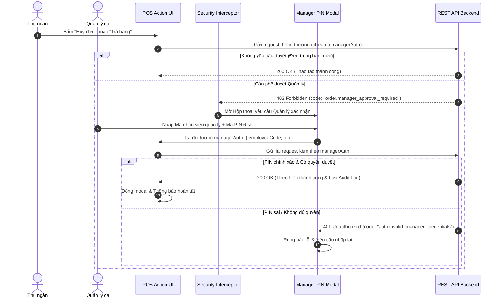

# SPEC-0011: Cơ chế Phê duyệt Quản lý & Bảo mật Thao tác Quầy (Manager PIN Override & Audit Security)

Tài liệu đặc tả kiến trúc cơ chế Kiểm soát quyền hạn cao (High-Privilege Interceptor), Hộp thoại Phê duyệt Quản lý bằng mã PIN (Manager PIN Challenge) và Ghi nhật ký kiểm toán (Audit Trail) cho các thao tác nhạy cảm tại quầy POS Bitexco SkyStore.

---

## 🎯 Phạm vi & Ranh giới (Scope & Boundaries)

- **LÀM GÌ (In Scope):**
  - Đánh chặn các hành động nhạy cảm đòi hỏi sự cho phép của Quản lý ca (Store Manager / Shift Supervisor):
    - **Hủy đơn hàng** đã tạo (`cancel-order`).
    - **Trả hàng & Hoàn tiền** cho khách (`refund-order`).
    - **Đổi hàng** mới (`exchange-order`).
    - **Chiết khấu đặc biệt vượt hạn mức** nhân viên thu ngân.
    - **Chốt ca khi có chênh lệch tiền mặt lớn** (Discrepancy Override).
  - Tự động hiển thị Hộp thoại xác thực Quản lý (Manager PIN Modal) khi máy chủ trả mã lỗi `403 order.manager_approval_required`.
  - Thu thập thông tin phê duyệt gồm Mã Quản lý (`employeeCode`) và Mã PIN bảo mật (`pin`).
  - Gửi kèm đối tượng `managerAuth` trong payload để Backend xác thực và ghi vết kiểm toán (Audit Log).
  - Xử lý các mã lỗi xác thực quản lý: `401 auth.invalid_manager_credentials`, `401 auth.insufficient_manager_permissions`.
- **KHÔNG LÀM GÌ (Out of Scope):**
  - Không phân quyền trực tiếp trên máy POS (quyền được quản lý tập trung từ hệ thống IAM của Backend).

---

## 1. Đường ống & Luồng dữ liệu (Manager Challenge Flow)



---

## 2. Bảng Cấu trúc Dữ liệu & Payloads

### 2.1 Đối tượng Xác thực Quản lý (`ManagerAuth`)

| Trường         | Kiểu dữ liệu | Ý nghĩa                             |
| :------------- | :----------- | :---------------------------------- |
| `employeeCode` | `string`     | Mã nhân viên quản lý (VD: `MGR001`) |
| `pin`          | `string`     | Mã PIN bảo mật (thường là 4-6 số)   |

### 2.2 Ví dụ Payload Hủy Đơn hàng có Duyệt Quản lý (`POST /v1/pos/orders/:id/cancel`)

```json
{
  "orderId": "019fb740-ord-001",
  "shiftId": "01a09ee3-e256-7453-9e94-15a74b5fdf24",
  "staffId": "e1000000-0000-0000-0000-000000000005",
  "reason": "Khách hàng đổi ý trước khi in hóa đơn",
  "managerAuth": {
    "employeeCode": "MGR001",
    "pin": "123456"
  }
}
```

---

## 3. Giải trình Lý do Thiết kế (Design Rationale / HOW & WHY)

1. **Vì sao thiết kế cơ chế Interceptor bắt lỗi `403` thay vì kiểm tra quyền trước ở Client?**
   - Phân quyền động tại Server là phương án an toàn và linh hoạt nhất. Chính sách duyệt có thể thay đổi trên Backoffice (ví dụ: đổi ngưỡng cần duyệt từ 500,000đ lên 1,000,000đ) mà không cần phải cập nhật hay triển khai lại mã nguồn ứng dụng Mobile POS.
2. **Bảo mật mã PIN quản lý tại Client:**
   - Mã PIN chỉ được lưu tạm thời trong bộ nhớ RAM trong suốt vòng đời của modal xác nhận, tuyệt đối không lưu xuống AsyncStorage / SecureStore hay ghi ra console log nhằm đảm bảo an toàn thông tin vận hành.
